<div class="cover">

# I-ITSM

## Intelligent IT Service Management & Incident Resolution System

**CS F213 / MAC F212 — Object-Oriented Programming**
Semester I, 2026–2027 · Project Report

| | |
|---|---|
| | |
|---|---|
| **Group No.** | <96> |
| **Student Name** | Garvit Phukela |
| **BITS ID** | 2025A7PS0936H |
| **Branch** | B.E. Computer Science (A7) |
| **Campus** | BITS Pilani, Hyderabad Campus |
| **Repository** | https://github.com/garvitphukela/intelligent-it-service-management- |
| **Live Deployment** | https://itsm-273t.onrender.com |
| **Demo Video** | To be added after recording |

</div>

<div class="toc">

**Contents**

1. Problem Analysis
2. Requirements Specification
3. System Architecture
4. UML Diagrams (use case, class, state, sequence)
5. Object-Oriented Design & Design Patterns
6. Intelligent Features & Algorithms
7. Technology Stack & Technology Selection Report
8. Database Design
9. Security, Exception Handling & SLA Management
10. Testing
11. User Interface Walkthrough
12. Project Demonstration Plan
13. Team Responsibilities
14. Innovation, Limitations & Future Work
15. How to Run

</div>

---

## 1. Problem Analysis

### 1.1 Problem

Organisations depend on dozens of IT services — payment platforms, identity/SSO, databases, networks, e-mail, cloud storage. When a service fails, employees must report it, and the IT team must **identify, prioritise, assign, investigate, resolve and close** the incident quickly. Done by e-mail or spreadsheet, this produces delayed responses, wrong priorities, overloaded or idle technicians, missed SLAs, duplicate tickets for the same outage, incomplete history and no visibility into recurring problems.

### 1.2 Stakeholders

| Stakeholder | Interest |
|---|---|
| Employees / customers | Report problems easily, know the status, get them fixed fast |
| Technicians / support engineers | A clear, prioritised queue; context to fix quickly; manageable workload |
| Team leads | Catch unacknowledged critical incidents; balance the team |
| System administrators | Configure services, categories, SLAs, routing; audit everything |
| IT managers | SLA compliance, service health, trends, customer satisfaction |
| Organisation / business owners | Minimise downtime of revenue-critical services |

### 1.3 Existing challenges → what I-ITSM does about each

| Challenge (from the brief) | I-ITSM response |
|---|---|
| Delayed response | Automatic routing on creation; live notifications (in-app, e-mail, SMS for P1); SLA countdowns |
| Incorrect prioritisation | Explainable priority algorithm using impact, urgency, business criticality and affected users |
| Inefficient technician allocation | Four pluggable assignment strategies incl. *Smart* (skills + workload + experience + service history) |
| SLA violations | Per-service SLA policies, continuous background monitoring, early warnings, predictive risk, escalation |
| Poor service visibility | Real-time operations dashboard over WebSocket; service and technician analytics |
| Duplicate reports | TF-IDF similarity on create, same-reporter duplicate guard, duplicate linking with automatic co-resolution |
| Incomplete history | Immutable audit trail written by an Observer for every event |
| Recurring problems | Resolution knowledge reuse ("suggested resolutions"), correlation via service dependency graph |

### 1.4 Proposed solution

A full-stack web application: a **Spring Boot 4 / Java 21** backend whose core is a rich, framework-independent **domain model** (incidents with a State-pattern lifecycle, user hierarchy, services with a dependency graph, SLA policies), surrounded by **Strategy**, **Observer**, **Factory**, **Adapter** and **Repository** implementations; and a **React + TypeScript** single-page app with role-specific portals. PostgreSQL persists data; the app ships as one Docker image.

### 1.5 Assumptions

1. One organisation (single tenant); users authenticate with e-mail + password (SSO integration is future work).
2. Employees self-register; staff accounts (technicians, team leads, admins, managers) are created by administrators.
3. A technician's skills are expressed with the same vocabulary as category *required skills* (e.g. `NETWORK`, `DATABASE`).
4. SLA clocks run in calendar time (24×7). The resolution clock **pauses** while waiting for the reporter.
5. E-mail is sent through SMTP when configured; otherwise, like SMS, it is **simulated** and recorded in the notification log (the brief allows simulation).
6. For demonstration, SLA policy times can be compressed with a configurable **time-scale** (default ×10) so breaches and escalations happen within minutes on camera.

---

## 2. Requirements Specification

### 2.1 User roles

| Role | Is-a | Capabilities |
|---|---|---|
| **Employee** | User | Register/login, report incidents, view own incidents, track status, add comments, answer information requests, verify or reopen resolution, give feedback |
| **Technician** | User | View queue & workload, acknowledge, start work, add (internal) investigation notes, request information, resolve, close, link duplicates, toggle availability, view operations dashboard |
| **Team Lead** | Technician | Everything a technician can do + assign/reassign any incident + receives level-1 escalations |
| **Administrator** | User | Manage users/technicians, IT services, categories, SLA policies, strategies; monitor incidents; reports; audit and notification logs; run SLA check |
| **IT Manager** | Administrator | Same as administrator; final escalation tier |

### 2.2 Functional requirements

| ID | Requirement | Where |
|---|---|---|
| FR-1 | Users register, log in and receive a JWT; roles determine available UI and API | `AuthService`, `SecurityConfig` |
| FR-2 | Employees create incidents with title, description, affected service, optional category, impact, urgency, affected users | `IncidentService.create` |
| FR-3 | On creation the system classifies (auto or chosen), calculates priority, applies the SLA, and assigns a technician | `IncidentService.classify`, `tryAutoAssign` |
| FR-4 | Incident lifecycle NEW → CLASSIFIED → ASSIGNED → ACKNOWLEDGED → IN_PROGRESS ⇄ AWAITING_INFO → RESOLVED → VERIFIED → CLOSED, plus CANCELLED and REOPEN; illegal transitions are rejected | `domain.incident.*State` |
| FR-5 | Technicians acknowledge, investigate, add notes, request information, resolve; reporters verify/reopen and rate | `IncidentController` |
| FR-6 | Team leads / admins assign manually (with ranked recommendations) or automatically | `AssignmentService` |
| FR-7 | At least two assignment strategies, switchable at runtime | 4 strategies + `StrategyRegistry` |
| FR-8 | SLA deadlines computed, tracked, warned and breaches recorded | `SlaTracker`, `SlaMonitoringService` |
| FR-9 | Notifications on create, assign, priority change, SLA approaching/violated, resolve, close, escalate — at least two channels | In-app (WebSocket), e-mail, SMS |
| FR-10 | Complete audit trail with timestamp, user, action, incident, previous/new state, description | `AuditTrailListener` |
| FR-11 | Search by ≥5 criteria | 10 criteria: number, keyword, status, priority, category, service, technician, SLA status, date range, flags |
| FR-12 | Reports/dashboards: overview, technician workload, service analysis, SLA compliance, trend, category breakdown | `ReportService` |
| FR-13 | ≥2 intelligent features | 6 features (§6) |
| FR-14 | Administrators manage users, technicians, services (with dependencies), categories, SLA policies | `AdminController` |
| FR-15 | Persistence of users, services, incidents, technicians, SLA policies, audit, resolutions | PostgreSQL via JPA |

### 2.3 Non-functional requirements

| ID | Category | Requirement & how it is met |
|---|---|---|
| NFR-1 | Maintainability | Layered architecture; domain has no Spring dependencies in its logic; patterns isolate change (new strategy / state / channel / category = new class or data row) |
| NFR-2 | Extensibility | Categories, services, SLA policies are data; strategies and channels discovered automatically by Spring |
| NFR-3 | Security | BCrypt passwords, stateless JWT, role-based URL + method security, ownership checks, Bean Validation, CORS, no entity leakage (DTOs) |
| NFR-4 | Reliability | Optimistic locking (`@Version`) on incidents; listener failures isolated from business transactions; SLA monitor tolerant of concurrent updates |
| NFR-5 | Usability | Role-specific portals, live analysis while typing, explainable decisions (priority rationale, recommendation breakdown), responsive layout, light/dark |
| NFR-6 | Performance | Indexed status/priority/date columns; paginated search; similarity computed over a bounded recent window |
| NFR-7 | Observability | Spring Actuator health; structured logs; notification log for every delivery |
| NFR-8 | Portability | One Docker image; H2 for dev, PostgreSQL for prod; 12-factor env configuration |
| NFR-9 | Testability | Injected `Clock`; pure domain objects; 57 automated tests |

### 2.4 Business rules

1. **BR-1** An incident cannot skip lifecycle stages (e.g. NEW → CLOSED is rejected with `INVALID_STATE_TRANSITION`).
2. **BR-2** Only the assigned technician, a team lead or management may acknowledge, work on or resolve an incident.
3. **BR-3** Employees see only their own incidents and never see internal work notes.
4. **BR-4** A technician cannot be manually assigned beyond their maximum workload (`WORKLOAD_EXCEEDED`) or when unavailable (`TECHNICIAN_UNAVAILABLE`).
5. **BR-5** The response SLA is satisfied by acknowledgement; the resolution SLA by resolution. The resolution clock pauses in AWAITING_INFO and the deadline shifts by the paused time.
6. **BR-6** Service-specific SLA policies override defaults; default policies cannot be deleted (every priority must have a fallback).
7. **BR-7** Unacknowledged P1/P2 incidents escalate at 100 % (Team Lead, reassigned), 150 % (Administrators) and 200 % (IT Managers) of the response window.
8. **BR-8** A reporter submitting a ≥85 % similar incident on the same service while their first is open gets `DUPLICATE_INCIDENT` unless they explicitly force it.
9. **BR-9** Incidents linked as duplicates are resolved automatically when their master is resolved; a duplicate cannot itself be a master.
10. **BR-10** Feedback (1–5) can be given once, by the reporter, after resolution.
11. **BR-11** Service dependencies must be acyclic.
12. **BR-12** Self-registration always creates an Employee; an administrator cannot deactivate their own account.

---

## 3. System Architecture

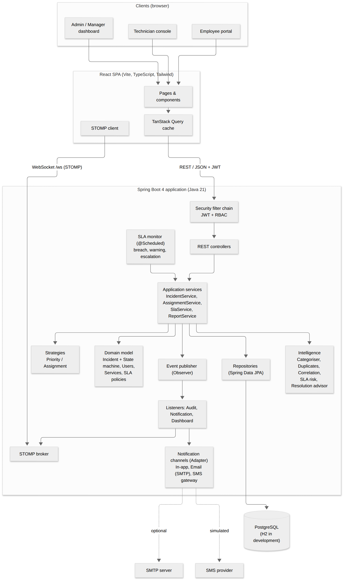

**Layers** (top to bottom): React SPA → REST/WebSocket → security filter chain → controllers (thin, map HTTP ↔ DTO) → application services (transactions, orchestration, authorisation) → **domain model** (business rules) + strategies + intelligence → repositories → PostgreSQL. Cross-cutting: an **event publisher** fans out domain events to audit, notification and dashboard listeners; a **scheduled SLA monitor** drives time-based behaviour.

**Key interactions**

* *Create incident:* controller → `IncidentService` → `IncidentFactory` → `AutoCategorizer` → active `PriorityStrategy` → `SlaService` → active `AssignmentStrategy` → `Incident` state transitions → events → listeners (audit row, notifications via channel adapters, WebSocket broadcast).
* *Background:* every N seconds `SlaMonitor` → `SlaMonitoringService.runCycle()` → breach/warning detection, predictive risk, `EscalationService`, `IncidentCorrelator` → events.
* *Real-time:* the SPA keeps a STOMP connection (`/ws`), subscribes to `/topic/events` (staff) and `/user/queue/notifications` (per user) and invalidates its query cache when events arrive.

**Package structure (backend `com.itsm`)**

| Package | Responsibility |
|---|---|
| `domain.user` | `User` hierarchy, `Role`, `UserFactory` |
| `domain.incident` | `Incident` aggregate, value objects, enums, **State pattern** classes |
| `domain.catalog` | `ITService` (dependency graph), `Category`, `SlaPolicy` |
| `domain.audit`, `domain.notification`, `domain.settings` | Audit entries, notifications, persisted settings |
| `priority`, `assignment` | **Strategy pattern** families |
| `event` | **Observer pattern**: events, publisher, listener contract |
| `notification` | **Adapter pattern** channels, factory, routing service |
| `intelligence` | NLP, TF-IDF, categoriser, duplicates, correlation, SLA risk, resolution advisor |
| `service` | Application services, access policy, SLA monitor, escalation, reports |
| `repository` | **Repository pattern** (Spring Data JPA) |
| `security`, `web`, `config`, `exception` | JWT, controllers/DTOs/error handling, configuration & seeding, exception hierarchy |

---

## 4. UML Diagrams

### 4.1 Use case diagram

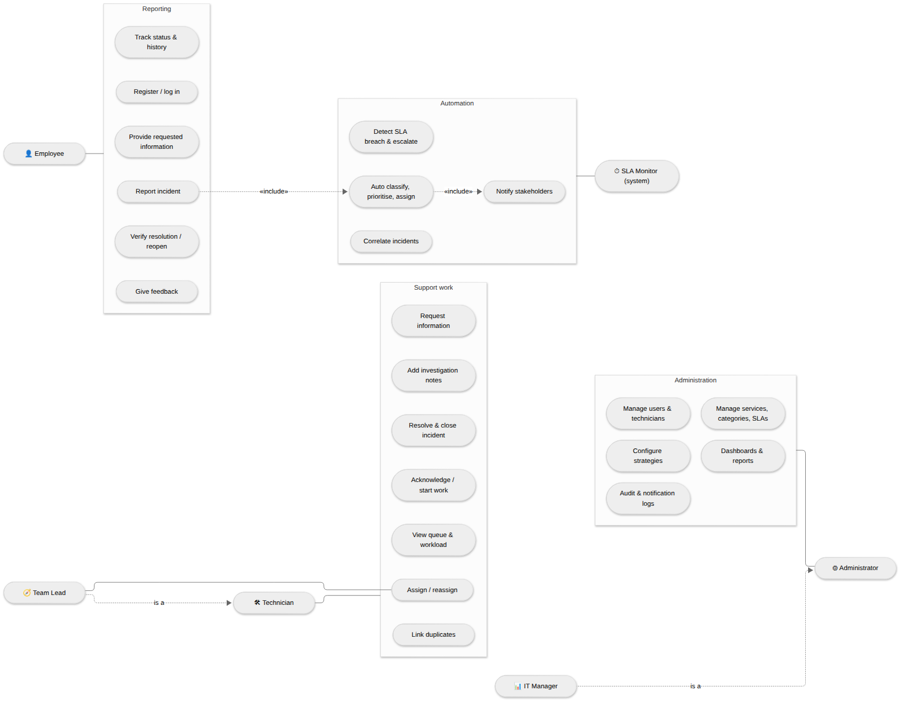

Generalisation between actors mirrors the class hierarchy: a **Team Lead is a Technician**, an **IT Manager is an Administrator**. *Report incident* «includes» automatic classification, prioritisation and assignment, which in turn «includes» notification.

### 4.2 Class diagram — domain model

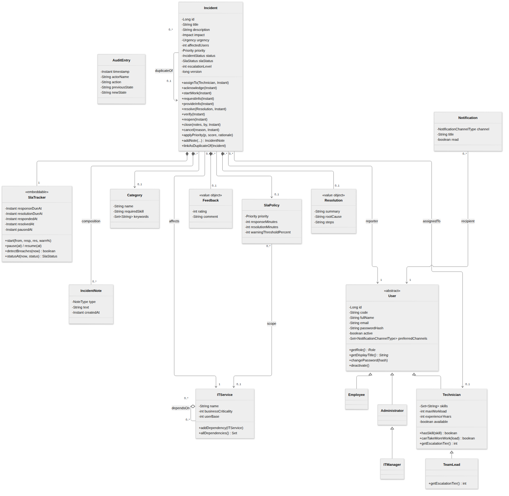

* **Inheritance** — `User` (abstract) → `Employee`, `Technician` → `TeamLead`, `Administrator` → `ITManager`. Abstract `getRole()` / `getDisplayTitle()` are overridden polymorphically; `Technician.getEscalationTier()` is overridden by `TeamLead`.
* **Composition (filled diamond)** — `Incident` owns its `IncidentNote`s (cascade + orphan removal), `SlaTracker`, `Resolution` and `Feedback`; they have no life outside the incident.
* **Aggregation (hollow diamond)** — `ITService` *dependsOn* other services that exist independently.
* **Association** — `Incident` → reporter `User`, assigned `Technician`, `ITService`, `Category`, `SlaPolicy`; self-association *duplicateOf*.

### 4.3 Class diagrams — design patterns

**State pattern (incident lifecycle)**

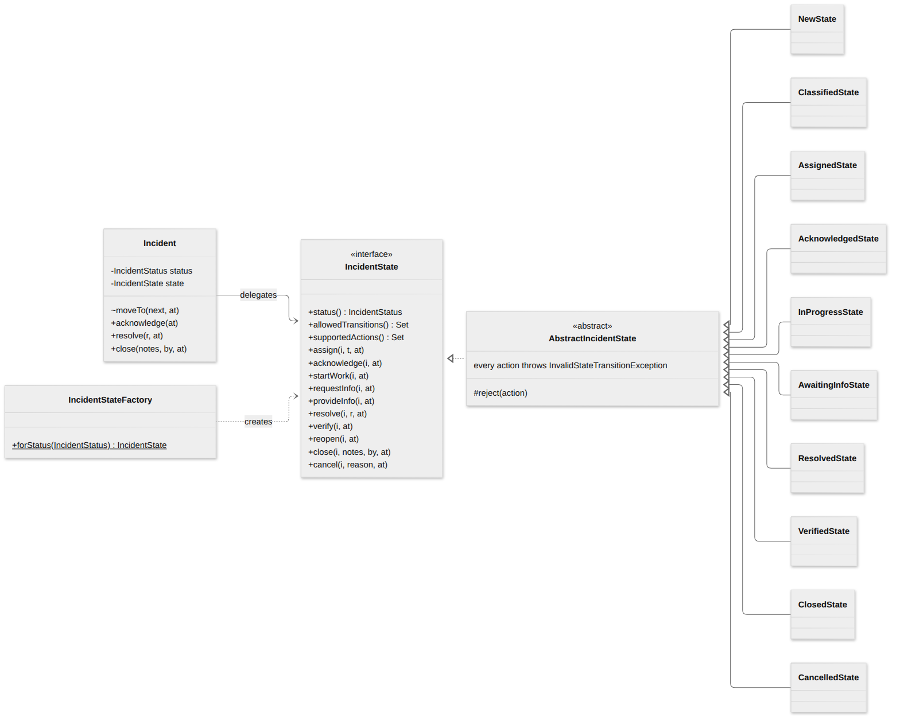

**Strategy pattern (priority & assignment)**

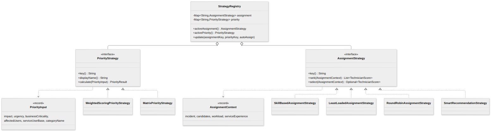

**Observer + Adapter + Factory + Template Method (events & notifications)**

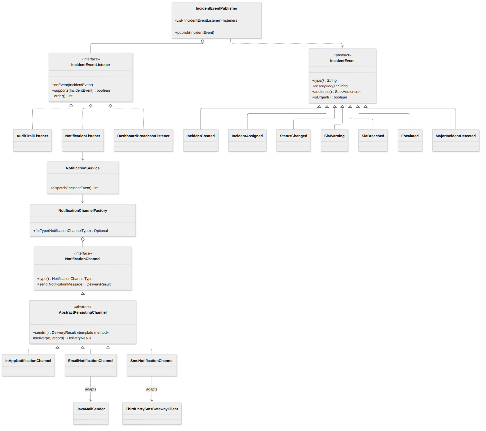

### 4.4 State machine diagram

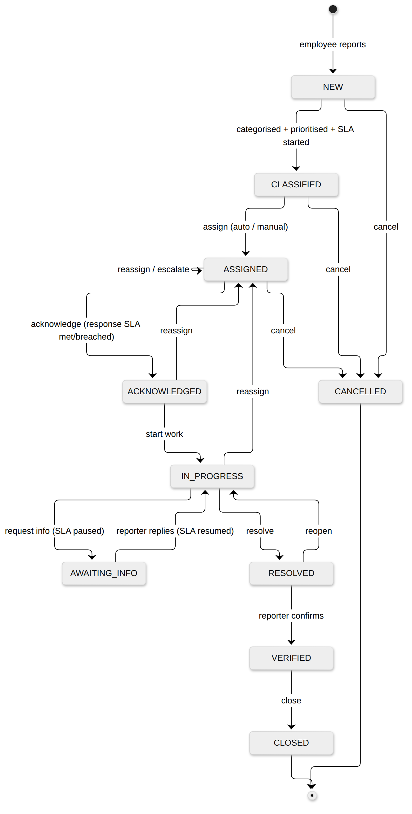

### 4.5 Sequence diagrams

**Workflow 1 — Employee reports → system prioritises → technician assigned → notification generated**

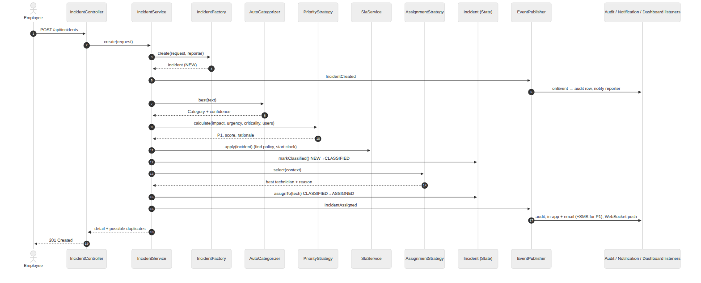

**Workflow 3 — Background SLA monitoring, escalation and correlation**

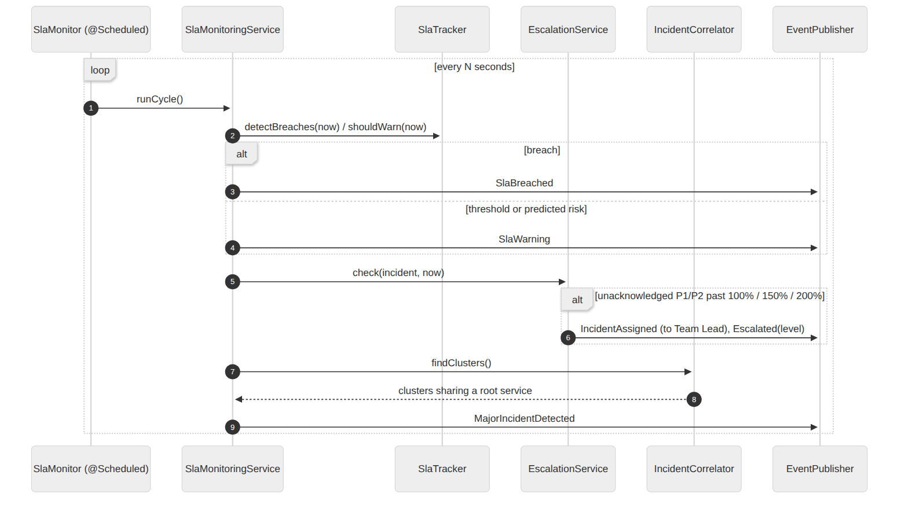

---

## 5. Object-Oriented Design & Design Patterns

### 5.1 OOP concepts → code

| Concept | Where & how |
|---|---|
| **Encapsulation** | `Incident` has **no public setters**: state changes only via intention-revealing methods (`assignTo`, `resolve`, `applyPriority`…). Collections are exposed read-only (`Collections.unmodifiableList`, `Set.copyOf`). `Incident.moveTo(...)` is *package-private* so only state classes in the same package can change status. `AuditEntry` is immutable (no setters at all). |
| **Abstraction** | `IncidentState`, `PriorityStrategy`, `AssignmentStrategy`, `NotificationChannel`, `IncidentEventListener` describe *what* without *how*. `SlaTracker` hides deadline arithmetic behind `detectBreaches`, `statusAt`, `pause/resume`. |
| **Inheritance** | Only genuine is-a relationships: `TeamLead extends Technician` (a team lead still resolves incidents), `ITManager extends Administrator`; `AbstractIncidentState` provides default "reject" behaviour to 10 concrete states; `AbstractPersistingChannel` is the base for channels; `ItsmException` roots 15 exception types. |
| **Polymorphism** | Runtime dispatch over `User.getRole()`, each `IncidentEvent.description()/audience()/isUrgent()`, each state's `resolve()`/`close()`, each strategy's `rank()`, each channel's `deliver()`. `NotificationService` handles any event subclass without `instanceof` chains (one exception, previous assignee, is documented). |
| **Interfaces** | 5 core contracts (state, two strategy families, listener, channel) plus Spring Data repository interfaces. |
| **Composition** | Incident aggregate (notes, SLA tracker, resolution, feedback). Services *compose* strategies, repositories and publishers via constructor injection rather than inheriting behaviour. |
| **Association / Aggregation** | Incident ↔ User/Technician/Service/Category/Policy; Service ↔ Service dependency graph; `StrategyRegistry` aggregates strategies; `IncidentEventPublisher` aggregates listeners. |
| **Exception handling** | Custom checked-at-boundary hierarchy (§9.2) mapped to HTTP by one `@RestControllerAdvice`. Domain throws `IllegalArgumentException`/`IllegalStateException` for invariant violations. |
| **Collections / data structures** | `EnumMap` for state flyweights and channel factory; `EnumSet` for status groups and notification preferences; `LinkedHashMap` for ordered score breakdowns; `ArrayDeque` BFS over the service dependency graph; `HashMap<String, Map<Long,Integer>>` term-category counts for the learning categoriser; `TreeMap` for date-ordered trend buckets; `AtomicLong` for thread-safe round-robin. |
| **Generics** | `PageView<T>`, typed repositories, `Optional<TechnicianScore>`. |
| **Records / value objects** | `PriorityInput` (validating compact constructor), `PriorityResult`, `AssignmentContext`, `TechnicianScore`, all DTOs. |

### 5.2 Design patterns (8 used; brief requires 2)

| Pattern | Problem it solves here | Implementation |
|---|---|---|
| **State** | Lifecycle rules would otherwise be a large `switch` duplicated across services; illegal transitions must be impossible | `IncidentState` + `AbstractIncidentState` + 10 states; `Incident` delegates every action to `state()`; `IncidentStateFactory` (stateless flyweights in an `EnumMap`) rebuilds the state from the persisted enum |
| **Strategy** | Priority rules and routing policies differ by organisation and change over time | `PriorityStrategy` (Weighted, ITIL Matrix), `AssignmentStrategy` (Skill, Load, Round-robin, Smart); `StrategyRegistry` selects by key stored in `system_settings`; admin switches at runtime |
| **Observer** | One business action must trigger audit, notifications and live UI without the service knowing about them | `IncidentEventPublisher` + `IncidentEventListener` (Audit, Notification, Dashboard) ordered by priority, failures isolated |
| **Factory** | Correct subclass creation and validation in one place | `UserFactory` (role → subclass), `IncidentFactory` (validated NEW incident), `NotificationChannelFactory`, `IncidentStateFactory` |
| **Adapter** | Third-party APIs (SMTP, SMS vendor SDK) have incompatible interfaces | `EmailNotificationChannel` adapts `JavaMailSender`; `SmsNotificationChannel` adapts `ThirdPartySmsGatewayClient.dispatch(msisdn, payload, flag)` to `send(NotificationMessage)` |
| **Repository** | Decouple domain from persistence technology | Spring Data JPA interfaces; dynamic queries with `Specification` |
| **Template Method** | Every channel must log deliveries identically | `AbstractPersistingChannel.send()` is `final`: creates record → calls abstract `deliver()` → stores status → hook `afterPersist()` |
| **Flyweight** | States carry no data, so one instance per status suffices | `IncidentStateFactory` shares state objects |

### 5.3 SOLID in practice

* **S** — `IncidentAccessPolicy` owns authorisation rules; `SlaService` owns policy lookup; controllers only translate HTTP.
* **O** — new category/service/SLA = data; new strategy/channel/listener = one new class, no edits elsewhere.
* **L** — every `IncidentState`, strategy and channel is substitutable; tests exercise all four assignment strategies through the same interface.
* **I** — small focused interfaces (a listener implements `onEvent`, optionally `supports`/`order`).
* **D** — services depend on interfaces (`List<AssignmentStrategy>`, `NotificationChannel`, repositories, `Clock`), injected by constructor.

---

## 6. Intelligent Features & Algorithms

Six intelligent/automated features are implemented (brief requires two). All are **rule-based / statistical** and explainable; no external AI service is required.

### 6.1 Priority determination (algorithm & rationale)

Default strategy — **Weighted scoring**:

```
base  = Impact(1..4) × Urgency(1..4) × BusinessCriticality(1..5)          range 1..80
users = 1.5 if affected ≥ 1000 or ≥ 50 % of the service's user base
        1.25 if ≥ 100 or ≥ 20 %;   1.1 if ≥ 10;   else 1.0
cat   = 1.2 SECURITY, 1.1 AUTHENTICATION, else 1.0
score = base × users × cat
P1 ≥ 36,  P2 ≥ 18,  P3 ≥ 8,  else P4
```

*Rationale.* Multiplying makes the factors **interact**: a mission-critical service with low urgency stays moderate, but high impact *and* urgency on a critical service escalates quickly. Thresholds were calibrated so that the brief's scenario (payment application unavailable for everyone: EXTENSIVE × CRITICAL × 5 = 80) is P1, "my team is blocked on a medium service" (MEDIUM × HIGH × 3 = 18) is P2, and single-user, low-urgency issues are P4. Affected users and security-sensitive categories *nudge* the score without dominating. Every incident stores a human-readable rationale, e.g. `Impact EXTENSIVE(4) x Urgency CRITICAL(4) x Criticality 5 = 80; x1.50 affected users (1500) x1.00 category => 120.0 -> P1`.

Alternative strategy — **ITIL matrix**: a 4×4 impact/urgency lookup, raised one level for criticality 5 and lowered one level for criticality 1.

### 6.2 Automatic categorisation (F)

`AutoCategorizer` combines a **rule-based** signal (administrator-maintained keywords, 2 points per hit, multi-word phrases supported) with a **learned** signal — P(category | term) estimated from all previously categorised incidents (a naive-Bayes style vote). Text passes through `TextAnalyzer`: lower-casing, tokenisation, stop-word removal, a light suffix stemmer and **synonym canonicalisation** (e.g. *unavailable/outage/offline → down*, *payment/transaction/checkout → pay*). Confidence = share of total score damped when evidence is thin. The suggestion is shown live while typing and applied on submit if the reporter leaves the category on "Auto-detect".

### 6.3 Duplicate detection (A)

`DuplicateDetector` builds a **TF-IDF** vector space over incidents from the last 7 days and computes **cosine similarity**, then adds +0.15 for the same service, +0.08 for a dependent service and +0.05 for the same category. ≥ 0.35 → "possible duplicate"; ≥ 0.60 → "likely duplicate" (a system note is added). The brief's example — *Payment application unavailable / Payment transaction failing / Unable to make payment* — is detected because all canonicalise to the shared term *pay* on the same service. Staff can link an incident to a master; duplicates are resolved together with it.

### 6.4 Incident correlation & root-cause hint (B)

`IncidentCorrelator` uses the **service dependency graph** (BFS over `dependsOn`). For each open P1–P3 incident in the last 120 minutes, every service it transitively depends on is a candidate root. A root explaining ≥3 incidents forms a cluster; clusters are ranked by size, direct reports and *specificity* (the closest shared dependency wins — Identity & Authentication rather than the Network beneath it), and clusters already explained by a larger one are dropped. New clusters mark incidents as **major incidents** and notify team leads, admins and managers.

### 6.5 SLA risk prediction & automatic escalation (C, E)

* Threshold warning at the policy's warning percentage (e.g. 75 %).
* **Predictive warning**: `SlaRiskPredictor` estimates expected resolution time from the historical average for the same *category × priority* and flags incidents predicted to finish after the deadline (risk ≥ 0.8), even if the clock is still early.
* **Escalation** of unacknowledged P1/P2 incidents: 100 % of response window → reassigned to the best available **Team Lead** (skill match, then least loaded); 150 % → **Administrators** notified; 200 % → **IT Managers** notified. Every step is audited and appears as a system note.

### 6.6 Smart technician recommendation (D) & suggested resolutions (G)

* **Smart recommendation**: weighted sum of skill match (0.40), spare capacity (0.25), experience (0.15, capped at 10 years) and past fixes on the same service (0.20). For P1/P2 the weights shift to experience 0.25 / load 0.15. The UI shows the ranked list with a per-factor bar and a reason sentence.
* **Suggested resolutions**: TF-IDF similarity against resolved incidents (+ category/service boosts); top 3 distinct fixes are shown to the technician and can pre-fill the resolve dialog. Employees also see "known fixes" while reporting.

---

## 7. Technology Stack & Technology Selection Report

### 7.1 Stack

| Layer | Technology | Purpose |
|---|---|---|
| Language (backend) | **Java 21 (LTS)** | Records, sealed-style hierarchies, switch expressions, strong typing |
| Framework | **Spring Boot 4.1** (Spring Framework 7, Spring Security 7, Spring Data JPA, Hibernate 7.4) | DI, web MVC, security, persistence, scheduling, WebSocket |
| Auth | **JJWT 0.13**, BCrypt | Stateless JSON Web Tokens, password hashing |
| Real-time | Spring WebSocket + **STOMP** simple broker | Live dashboard and notifications |
| API docs | **springdoc-openapi 3** | Swagger UI at `/swagger-ui.html` |
| Database | **PostgreSQL 17** (prod), **H2** (dev/test) | Relational persistence |
| Frontend | **React 19 + TypeScript + Vite 8** | SPA |
| UI | **Tailwind CSS 4**, Radix UI primitives, Plus Jakarta Sans + JetBrains Mono, lucide icons, Sonner toasts | Accessible, consistent design system with its own brand |
| Data fetching | **TanStack Query 5**, `@stomp/stompjs` | Caching, invalidation on live events |
| Charts | **Recharts 3** | Trend line chart |
| Testing | JUnit 5, AssertJ, Spring MockMvc, parameterised tests | Unit + integration |
| DevOps | **Docker** (multi-stage), Docker Compose, **GitHub Actions** CI, **Render** blueprint | Build, test, deploy |
| Tooling | Maven wrapper, npm, Mermaid (diagrams), Playwright (screenshots) | |

### 7.2 Technology selection — answers to the nine questions

**1. Why Java?** It is the course's OOP language, and its explicit constructs — `interface`, `abstract`, access modifiers, package-private visibility, checked inheritance — make the design *visible* in code. Java 21 adds records (immutable value objects), switch expressions and pattern matching (`instanceof Technician t`), which keep domain code concise without losing type safety.

**2. Why React (+TypeScript)?** The brief requires different GUIs for different users and live updates. React's component model lets three portals share primitives (badges, tables, dialogs) while differing in layout; TypeScript mirrors the backend DTOs so contract mismatches are compile errors; the ecosystem provides accessible primitives (Radix) and real-time clients.

**3. Why Spring Boot?** It is the most mature Java platform for enterprise back-ends and strongly supports OOP design: constructor **dependency injection** means services depend on interfaces (`List<AssignmentStrategy>` is auto-discovered — this is how adding a strategy requires zero wiring), plus first-class security, JPA, scheduling and WebSocket in one coherent stack.

**4. Why PostgreSQL?** Incidents, users, services and SLAs are highly relational with integrity constraints (FKs, unique codes) and need transactional updates (optimistic locking). PostgreSQL is free, robust and offered by every cloud; H2 gives zero-install development and fast in-memory tests with the same JPA mappings.

**5. Why this architecture?** A layered monolith with a rich domain model is the right size for a 5-person team and a 120-mark brief: one deployable, simple transactions, easy local runs — while internal boundaries (domain, strategies, events, adapters) are clean enough to extract services later. Real-time is added via WebSocket rather than polling.

**6. Alternatives considered.** *Node/Express + MongoDB* (fast to build but weaker static typing for OOP and no relational integrity for audit/SLA data); *Django* (productive but its ORM/admin hides much of the OOP design we are graded on); *microservices* (operational overhead disproportionate to the scope); *Flutter mobile* (a web app reaches all staff without installs).

**7. Advantages & limitations.** *Advantages:* type safety end-to-end, mature security, testable domain, one-command Docker run, live UI. *Limitations:* JVM memory footprint (~300 MB) and cold-start time on free hosting; the in-memory STOMP broker and scheduled monitor assume a single instance; similarity models are rebuilt per request (fine for thousands, not millions, of incidents).

**8. How does the technology support OOP?** Java enforces encapsulation and explicit contracts; JPA maps the inheritance hierarchy (`SINGLE_TABLE` with a discriminator), composition (`@Embedded`, `cascade + orphanRemoval`) and associations (`@ManyToOne`, `@ManyToMany`) directly from the object model; Spring DI enables Strategy/Observer/Factory without static coupling.

**9. Scaling to many more users.** (a) Run several stateless app instances behind a load balancer (JWT means no session affinity). (b) Replace the simple STOMP broker with RabbitMQ/Redis relay and move the SLA monitor to a single leader (ShedLock) or a queue-driven worker. (c) Move report aggregation to SQL `GROUP BY` / materialised views or a read replica. (d) Replace in-request TF-IDF with PostgreSQL full-text search or a vector index (pgvector/OpenSearch). (e) Publish events to Kafka for downstream consumers. (f) Add caching for catalog data. The domain model and interfaces stay unchanged — only adapters and infrastructure change.

---

## 8. Database Design

### 8.1 ER diagram

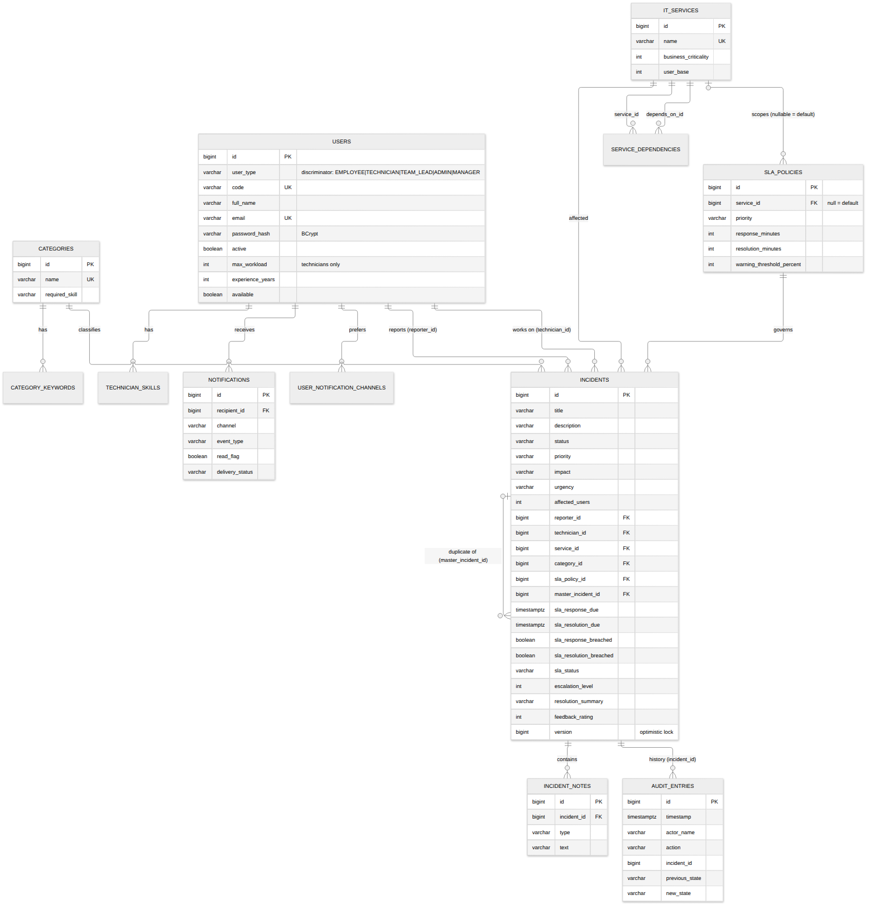

### 8.2 Important relationships

| Relationship | Cardinality | Mapping |
|---|---|---|
| User (reporter) → Incident | 1 : N | `incidents.reporter_id` FK |
| Technician → Incident | 1 : N (optional) | `incidents.technician_id` FK |
| ITService → Incident | 1 : N | `incidents.service_id` FK |
| ITService ↔ ITService (depends on) | M : N, acyclic | join table `service_dependencies(service_id, depends_on_id)` |
| ITService → SlaPolicy | 1 : N (NULL = default policy) | `sla_policies.service_id`, unique `(service_id, priority)` |
| Category → Incident | 1 : N | `incidents.category_id` |
| Incident → IncidentNote | 1 : N, composition | `incident_notes.incident_id`, cascade delete |
| Incident → Incident (duplicate of) | N : 1, optional | `incidents.master_incident_id` |
| Incident → AuditEntry | 1 : N (immutable history) | `audit_entries.incident_id` (no FK, so history outlives data changes) |
| User → Notification | 1 : N | `notifications.recipient_id` |
| User hierarchy | single table | `users.user_type` discriminator; technician columns nullable for other roles |

Embedded value objects (`SlaTracker`, `Resolution`, `Feedback`) are stored as columns of `incidents` (prefixes `sla_`, `resolution_`, `feedback_`), so loading an incident never needs extra joins for them. `incidents.version` supports optimistic locking. Indexes exist on `incidents(status)`, `(priority)`, `(created_at)`, `audit_entries(incident_id)`, `(timestamp)` and `notifications(recipient_id, read_flag)`.

### 8.3 Schema (PostgreSQL, generated from the JPA model)

The full DDL is in `docs/schema.sql` (13 tables). Excerpt:

```sql
CREATE TABLE incidents (
  id bigint PRIMARY KEY, version bigint NOT NULL,
  title varchar(200) NOT NULL, description varchar(4000) NOT NULL,
  status varchar(20) NOT NULL, priority varchar(5), priority_score double precision, priority_rationale varchar(500),
  impact varchar(12) NOT NULL, urgency varchar(12) NOT NULL, affected_users int NOT NULL,
  reporter_id bigint NOT NULL REFERENCES users, technician_id bigint REFERENCES users,
  service_id bigint NOT NULL REFERENCES it_services, category_id bigint REFERENCES categories,
  sla_policy_id bigint REFERENCES sla_policies, master_incident_id bigint REFERENCES incidents,
  sla_started_at timestamptz, sla_response_due timestamptz, sla_resolution_due timestamptz,
  sla_responded_at timestamptz, sla_resolved_at timestamptz, sla_paused_at timestamptz, sla_paused_seconds bigint,
  sla_response_breached boolean, sla_resolution_breached boolean, sla_warning_raised boolean, sla_status varchar(20),
  escalation_level int NOT NULL, major_incident boolean NOT NULL,
  resolution_summary varchar(1000), resolution_root_cause varchar(1000), resolution_steps varchar(4000),
  feedback_rating int, feedback_comment varchar(1000),
  closure_notes varchar(1000), closed_by varchar(140), closed_at timestamptz,
  created_at timestamptz NOT NULL, updated_at timestamptz
);
CREATE TABLE users (
  id bigint PRIMARY KEY, user_type varchar(31) NOT NULL,           -- EMPLOYEE | TECHNICIAN | TEAM_LEAD | ADMIN | MANAGER
  code varchar(20) UNIQUE NOT NULL, email varchar(160) UNIQUE NOT NULL, password_hash varchar(255) NOT NULL,
  full_name varchar(120) NOT NULL, phone varchar(30), department varchar(80), active boolean NOT NULL,
  max_workload int, experience_years int, available boolean          -- technician / team lead only
);
CREATE TABLE sla_policies (
  id bigint PRIMARY KEY, name varchar(80) NOT NULL, service_id bigint REFERENCES it_services,
  priority varchar(5) NOT NULL, response_minutes int NOT NULL, resolution_minutes int NOT NULL,
  warning_threshold_percent int NOT NULL, UNIQUE (service_id, priority)
);
```

### 8.4 Sample data

On first start the `DataSeeder` creates a realistic organisation (all passwords `Password@123`):

| Data | Content |
|---|---|
| IT services (10) | Network Infrastructure, Identity & Authentication, Core Database Cluster, Cloud Platform, Cloud Storage, Payment Gateway, Corporate Email, VPN Remote Access, HR Portal, Employee Devices — with criticality 2–5 and a dependency graph (e.g. Payment → Database, Auth, Cloud; Email → Auth → Network) |
| Categories (9) | HARDWARE, SOFTWARE, NETWORK, DATABASE, CLOUD, SECURITY, AUTHENTICATION, APPLICATION, STORAGE with keyword lists |
| SLA policies (6) | Defaults per the brief (P1 5 min/30 min … P4 4 h/24 h) + stricter Payment P1 (5/20) and P2 (10/60) |
| Users (14) | `admin@itsm.local` (A001), `manager@itsm.local` (M001), team leads L101/L102, technicians T101–T106 with different skills/experience, employees E101–E104 (`employee@itsm.local`, `karan@`, `pooja@`, `siddharth@`) |
| Incidents (56) | 52 historical incidents over 14 days, driven through the real state machine with resolutions, feedback and ~10 % SLA breaches; 4 live incidents in technician queues |

| id | title | status | priority | sla_status |
|---|---|---|---|---|
| 1 | Refunds stuck in pending state | RESOLVED | P2 | MET |
| 2 | Internet very slow in Block B | CLOSED | P1 | MET |
| 3 | Autoscaling not triggering on cloud cluster | CLOSED | P2 | MET |
| 4 | Monitor flickering constantly | CLOSED | P4 | MET |
| 5 | MFA codes not accepted | RESOLVED | P1 | MET |

---

## 9. Security, Exception Handling & SLA Management

### 9.1 Security

| Requirement | Implementation |
|---|---|
| Authentication | `POST /api/auth/login` verifies BCrypt hash, returns an HS-SHA signed JWT (12 h); `JwtAuthenticationFilter` validates every request; WebSocket CONNECT frames are authenticated with the same token |
| Role-based authorisation | URL rules (`/api/admin/** → ADMIN, MANAGER`; reports/audit → staff) **and** method-level `@PreAuthorize` (defence in depth) |
| Ownership / object-level rules | `IncidentAccessPolicy` (employees see only their incidents; only assignee/lead/admin can work; internal notes hidden) |
| Password protection | BCrypt (cost 10), password policy (≥8 chars, letters + digits), never returned by the API |
| Input validation | Bean Validation on all request records (`@NotBlank`, `@Size`, `@Email`, `@Min/@Max`); enum parsing; control-character stripping; sort-field allow-list |
| Secure API access | Stateless sessions, CSRF disabled only because no cookies are used, CORS allow-list, generic error messages for login failures, DTOs prevent over-posting and data leakage |
| Protection against unauthorised operations | Every lifecycle action re-checks role + ownership + state legality; self-deactivation blocked; self-registration limited to Employee |
| Secrets | JWT secret, DB credentials, SMTP credentials via environment variables (Render generates the JWT secret) |

*Not implemented (documented as future work):* refresh tokens and revocation, rate-limiting of login, MFA, HTTPS termination (provided by the hosting platform).

### 9.2 Exception hierarchy

All application exceptions extend `ItsmException` (code + HTTP status) and are translated by `GlobalExceptionHandler` into `{timestamp, status, code, message, path, fieldErrors}`.

| Situation (from brief) | Exception / response |
|---|---|
| Invalid login | `InvalidLoginException` → 401 `INVALID_LOGIN` |
| Unauthorised operation | `UnauthorizedOperationException` → 403; Spring `AccessDeniedException` → 403 `ACCESS_DENIED` |
| Invalid incident / not found | `IncidentNotFoundException` → 404 |
| Invalid state transition | `InvalidStateTransitionException` → 409 (carries current state + attempted action) |
| Technician unavailable | `TechnicianUnavailableException` → 409 |
| Technician workload exceeded | `WorkloadExceededException` → 409 |
| Service not found | `ServiceNotFoundException` → 404 |
| Missing SLA configuration | `SlaConfigurationMissingException` → 500 with guidance |
| Duplicate incident | `DuplicateIncidentException` → 409 (override with `force`) |
| Database failure | `DataAccessException` → 503 `DATABASE_FAILURE`; concurrent edit → 409 `CONCURRENT_MODIFICATION` |
| Network failure | `ExternalServiceException` → 502; frontend shows "Cannot reach the server" on fetch failure; notification channel failures are recorded as `FAILED` without breaking the business transaction |
| Invalid user input | Bean Validation → 400 `INVALID_INPUT` with per-field messages; malformed JSON/enum → 400 |

### 9.3 SLA management

* **Identify applicable SLA** — service-specific policy for the priority, else the default (`SlaService.resolvePolicy`).
* **Calculate deadlines** — response and resolution due times from creation (`SlaTracker.start`).
* **Track response time** — acknowledgement stamps `respondedAt`; **track resolution time** — resolution stamps `resolvedAt` (minus paused time).
* **Identify & record violations** — breach flags latch permanently; `SLA_VIOLATED` event → audit + notifications.
* **Warnings before deadlines** — configurable threshold + predictive risk.
* **Background processing** — `@Scheduled` monitor (default every 10 s in demo); admins can also trigger a cycle from the dashboard.
* **Pause/resume** — AWAITING_INFO pauses the resolution clock and shifts the deadline.

---

## 10. Testing

**57 automated tests, all passing** (`./mvnw test`), run on every push by GitHub Actions. Unit tests use pure domain objects with fixed instants (no Spring, no DB); integration tests boot the full application (security, MVC, JPA) against in-memory H2 with seeded data via MockMvc.

| Suite | Tests | Focus |
|---|---|---|
| `IncidentStateMachineTest` | 11 | State pattern, lifecycle rules |
| `SlaTrackerTest` | 4 | Deadlines, boundaries, warnings |
| `PriorityStrategyTest` | 11 (incl. 6 parameterised) | Both priority strategies, thresholds |
| `AssignmentStrategyTest` | 6 | All four assignment strategies |
| `IntelligenceTest` | 6 | NLP, TF-IDF duplicates, correlation, escalation levels |
| `DomainModelTest` | 5 | Factory, inheritance, invariants |
| `ApiIntegrationTest` | 14 | Auth, RBAC, validation, workflows, exceptions, search |

### 10.1 Documented test cases

| ID | Category | Test case | Expected result | Result |
|---|---|---|---|---|
| TC-01 | Normal | Full lifecycle CLASSIFIED → ASSIGNED → ACKNOWLEDGED → IN_PROGRESS → RESOLVED → VERIFIED → CLOSED | Ends CLOSED, response time recorded, SLA not breached | Pass |
| TC-02 | Business rule / Exception | Close a NEW incident | `InvalidStateTransitionException` mentioning NEW | Pass |
| TC-03 | Business rule | Resolve an incident that was only assigned | Rejected | Pass |
| TC-04 | Boundary | Any action on a CLOSED incident | All rejected; no allowed transitions | Pass |
| TC-05 | Business rule | Request info → wait 600 s → provide info | Status PAUSED while waiting; resolution deadline shifted by exactly 600 s | Pass |
| TC-06 | Normal | Reopen a resolved incident | Back to IN_PROGRESS, resolution cleared | Pass |
| TC-07 | Invalid input / Business rule | Cancel without reason; cancel after acknowledgement | `IllegalArgumentException`; transition rejected | Pass |
| TC-08 | Business rule | Reassign an acknowledged incident | Returns to ASSIGNED; new owner must acknowledge | Pass |
| TC-09 | Boundary / Invalid input | Feedback before resolution; rating 0 or 6 | Rejected | Pass |
| TC-10 | Invalid input | Link incident as duplicate of itself / of a duplicate | Rejected | Pass |
| TC-11 | Normal | SLA start at T0 with 5/30 min | Due T0+5 min / T0+30 min | Pass |
| TC-12 | Boundary | Check breach at exactly the deadline and 1 s later | Not breached at deadline; breached at +1 s; latched | Pass |
| TC-13 | Boundary | Warning at 74.7 % vs 75 % | No warning; warning; AT_RISK | Pass |
| TC-14 | Normal | Brief scenario: payment app down for everyone | P1, score 120, rationale text | Pass |
| TC-15 | Boundary | Minimum inputs | P4 | Pass |
| TC-16 | Boundary (×6) | Scores exactly on 36 / 18 / 8 thresholds and just below | Correct P1–P4 at each edge | Pass |
| TC-17 | Invalid input | Criticality 6; missing impact | `IllegalArgumentException` | Pass |
| TC-18 | Normal | Skill-based assignment with mixed loads | Skilled & least loaded first; unskilled last | Pass |
| TC-19 | Normal | Smart recommendation with service history | Senior DB engineer first; breakdown & reason present | Pass |
| TC-20 | Intelligent | Brief's three payment reports vs unrelated report | Related pairs similar (>0.2); unrelated 0 | Pass |
| TC-21 | Intelligent | Incidents on Email, VPN, Payment | One cluster, root = Identity | Pass |
| TC-22 | Boundary / Business rule | Escalation at 299 s, 300 s, 450 s, 600 s (5-min window) | Levels 0, 1, 2, 3 | Pass |
| TC-23 | Normal (OOP) | `UserFactory` for every role | Correct subclass; TeamLead is-a Technician; Manager is-a Administrator | Pass |
| TC-24 | Invalid input | Create circular service dependency | Rejected ("Circular") | Pass |
| TC-25 | Invalid input | SLA response > resolution; zero target; 100 % threshold | Rejected | Pass |
| TC-26 | Authorization | Valid admin login | 200 + JWT + role | Pass |
| TC-27 | Exception | Wrong password | 401 `INVALID_LOGIN` | Pass |
| TC-28 | Authorization | No token; employee → admin/report APIs | 401; 403; admin 200 | Pass |
| TC-29 | Authorization | Employee opens another employee's incident | 403 `UNAUTHORIZED_OPERATION` | Pass |
| TC-30 | Invalid input | Short title, empty description, missing service; bad enum | 400 with field errors | Pass |
| TC-31 | Exception | Unknown service id | 404 `SERVICE_NOT_FOUND` | Pass |
| TC-32 | Normal (integration) | Workflows 1+2 end-to-end via API | Auto P1, APPLICATION, Payments SLA, assigned; internal note hidden from reporter; SLA MET; audit sequence complete; reporter notified | Pass |
| TC-33 | Authorization / Business rule | Employee resolves; admin closes ASSIGNED incident | 403; 409 `INVALID_STATE_TRANSITION` | Pass |
| TC-34 | Business rule / Exception | Same reporter submits identical incident twice | 409 `DUPLICATE_INCIDENT`; `force=true` creates | Pass |
| TC-35 | Exception | Manual assignment above technician capacity | 409 `WORKLOAD_EXCEEDED` | Pass |
| TC-36 | Normal / Invalid input | Combined filters; search by number; unsafe sort field | Only matching rows; exactly 1; 400 | Pass |
| TC-37 | Normal / Invalid input | Switch assignment strategy; unknown strategy | Active = LOAD_BASED; 400 | Pass |
| TC-38 | Business rule | Delete default SLA policy; reports | 409; reports return data | Pass |
| TC-39 | Intelligent | Live analysis of an SSO problem | Category AUTHENTICATION, P1, suggested fixes | Pass |

### 10.2 Manual / exploratory testing

* Workflow 3 (three correlated authentication incidents, no acknowledgement) verified live: SLA warning → violation → reassignment to team lead → admin → manager escalation; major-incident cluster detected (see screenshots).
* Docker Compose stack with PostgreSQL verified: health UP, SPA served, all API workflows pass.
* Cloud deployment on Render (https://itsm-273t.onrender.com) verified with the same API workflow suite and a browser test confirming live WebSocket (`wss://`) updates.
* Responsive layout verified at 390 px (no horizontal scrolling) and in dark mode.

### 10.3 Bugs found and fixed during testing

| Bug | Fix |
|---|---|
| Duplicate stop-word made the analyser class fail to initialise (`Set.of` rejects duplicates) → 500 on analysis | Removed duplicate; added test coverage of the analyser |
| Jackson 3 rejects `null` for primitive request fields → 400 when optional flags omitted | Changed optional flags to boxed `Boolean` |
| Correlation over-included low-priority noise and produced overlapping clusters | Ignore P4; drop clusters that are subsets of a larger one; prefer the most specific shared dependency |
| Mail health indicator reported DOWN when SMTP is not configured | Disabled mail health (e-mail falls back to simulation) |
| Grid items overflowed on mobile | `min-width: 0` on cards |

---

## 11. User Interface Walkthrough

The UI has its own visual identity: a teal "beacon" mark (a signal ring around a core — an incident being watched), Plus Jakarta Sans for text and JetBrains Mono for identifiers and figures, cool neutral surfaces, and teal for primary actions, selection and focus. Other colour is reserved for meaning: red = critical/breached, amber = at risk/awaiting, green = resolved/met. Each role has its own navigation and home page.

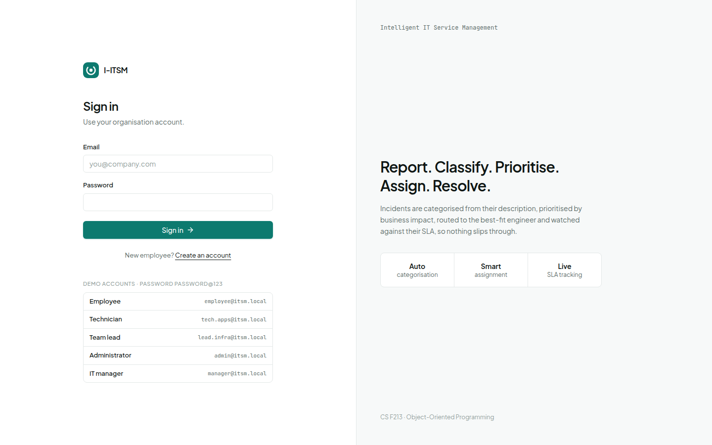

**Employee — report an incident with live analysis** (predicted priority & SLA, suggested category with confidence, possible duplicates, known fixes):

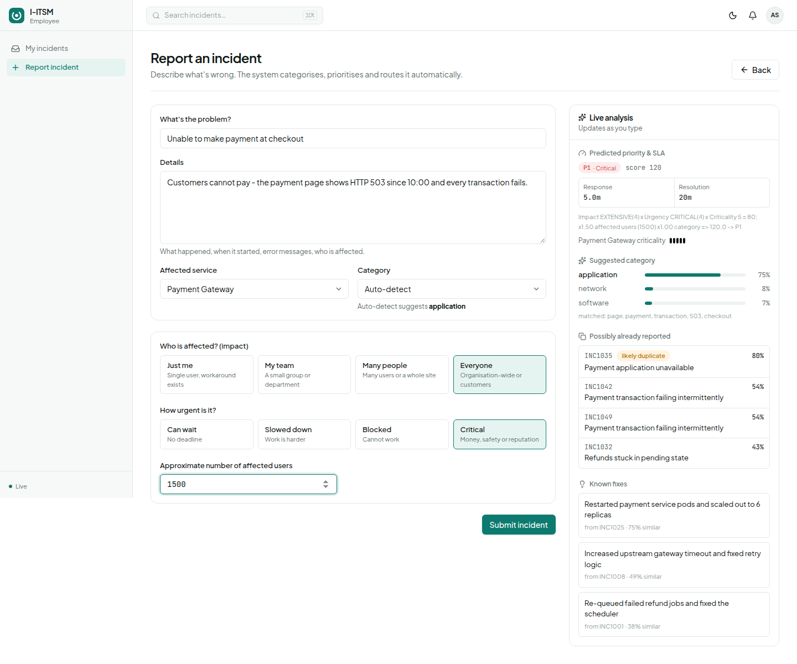

**Submission summary** — classification, priority, SLA, assignment and notification in one view:

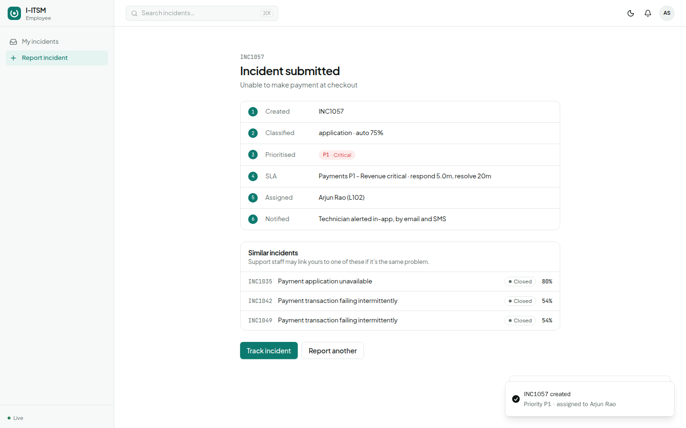

**Employee incident detail** — timeline, SLA panel, details and priority rationale:

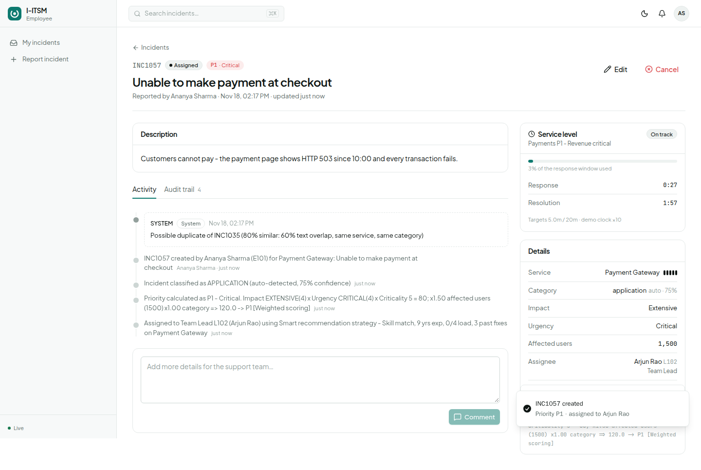

**Technician queue** — workload meter, availability toggle, SLA countdowns:

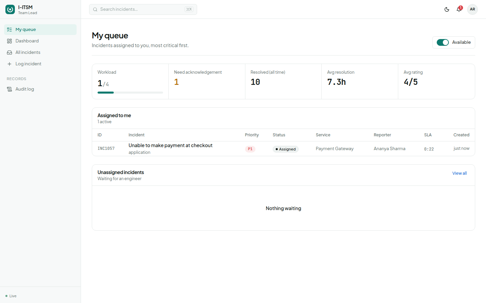

**Resolve with suggested fixes** (one click pre-fills the form):

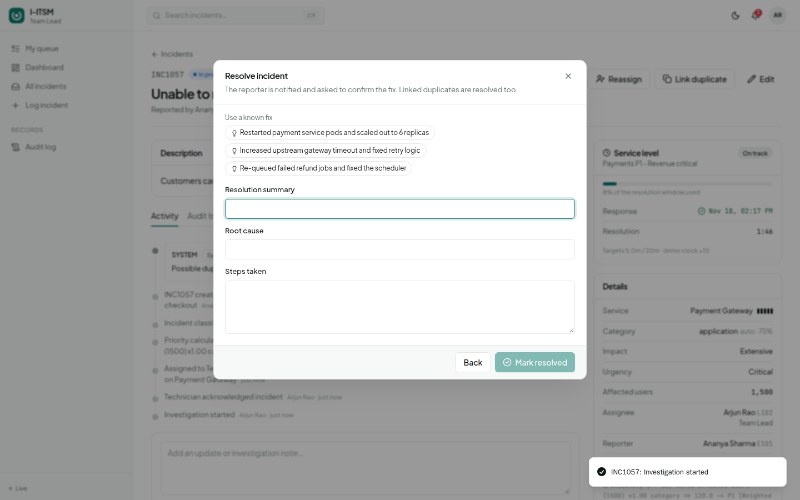

**Operations dashboard** — KPIs, trend, live activity (WebSocket), correlated incidents, SLA risk, technician workload, service analysis, SLA compliance, categories, recent violations:

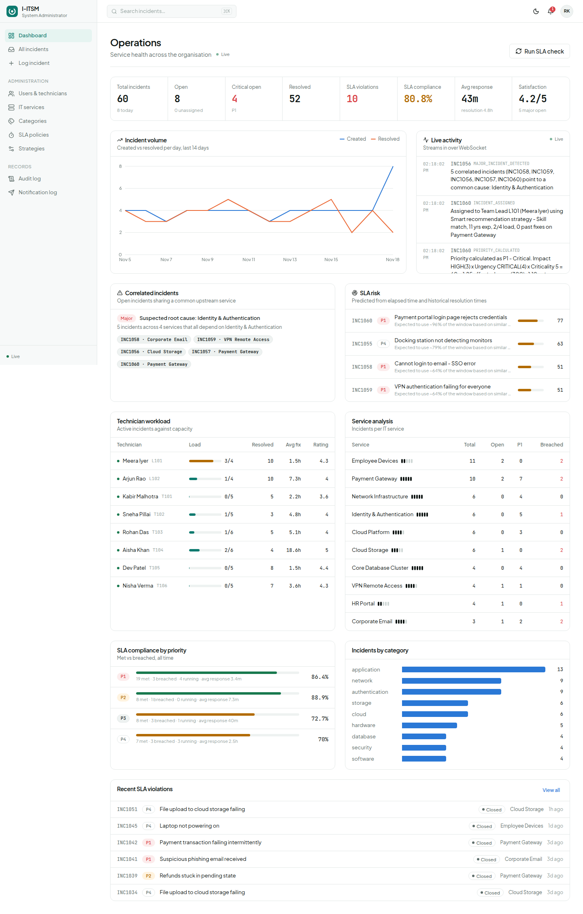

**Smart assignment** — ranked engineers with factor breakdown:

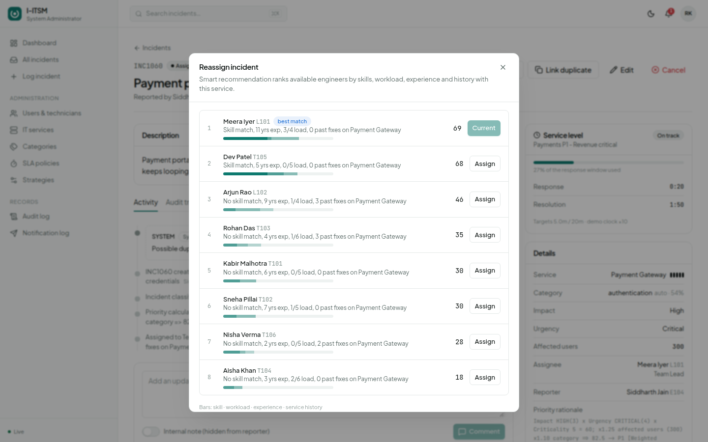

**Administration** — strategies switchable at runtime, SLA policies, audit log, notification log (simulated e-mail/SMS through adapters):

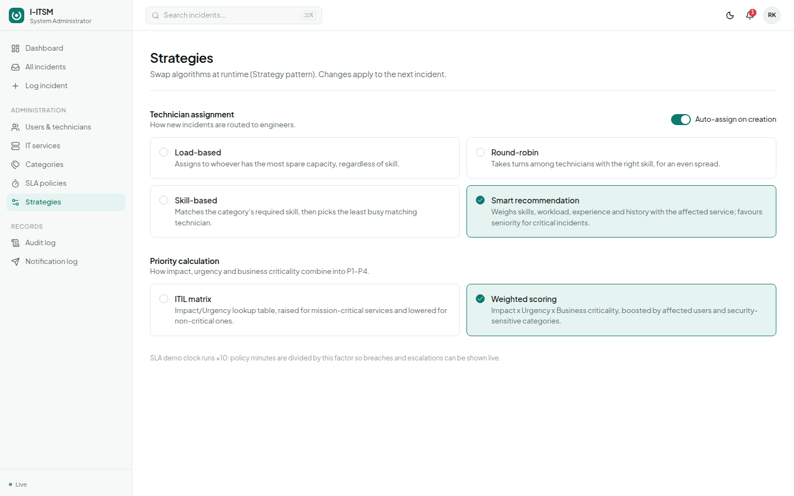

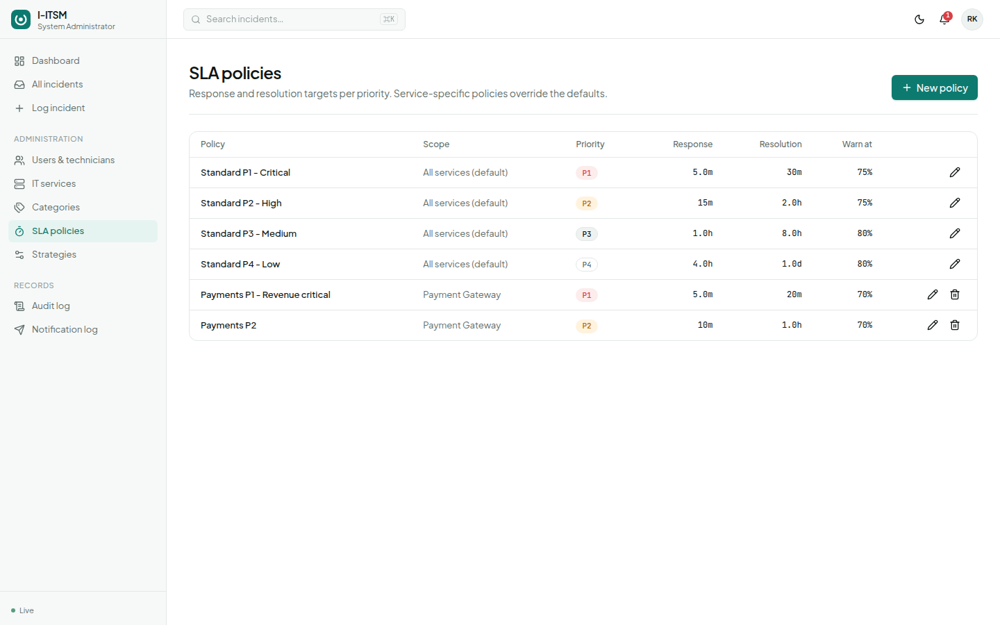

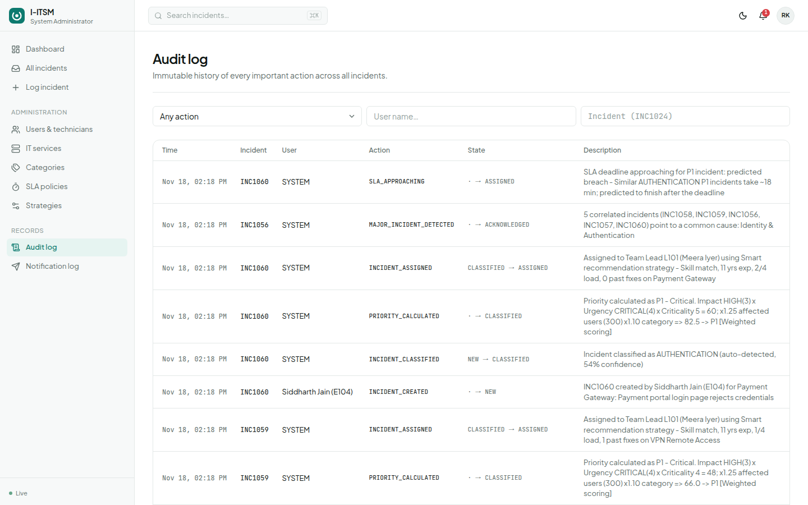

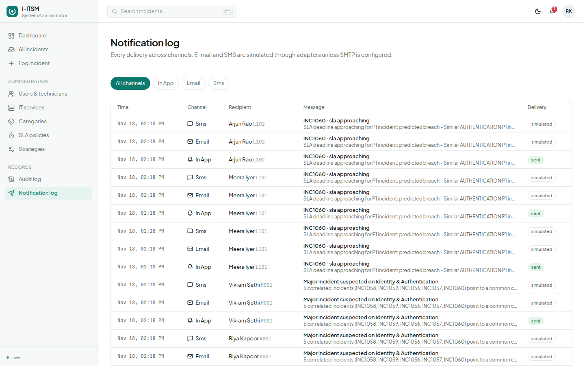

**Dark mode**:

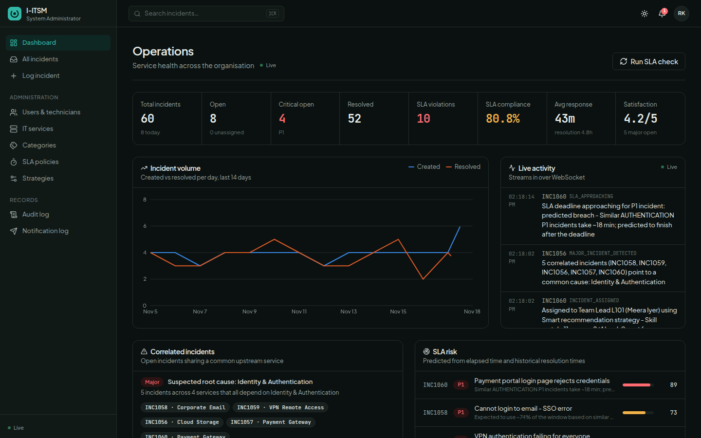

---

## 12. Project Demonstration Plan

The 15–20 minute video follows `docs/demo-script.md`. The three required workflows:

1. **Workflow 1** — Employee reports "Payment page down" → live analysis → submit → P1, APPLICATION, Payments SLA, auto-assigned by Smart strategy → technician sees in-app toast and dashboard updates live.
2. **Workflow 2** — Technician acknowledges, starts work, requests info (SLA pauses), employee replies, technician resolves using a suggested fix → employee notified, verifies and rates → closed; audit trail shown.
3. **Workflow 3** — Three employees report SSO-related failures on Email, VPN and Payment → duplicates flagged → correlation identifies *Identity & Authentication* as suspected root cause (major incident) → nobody acknowledges → SLA warning, violation and escalation Technician → Team Lead → Admin → Manager, all visible live and in the audit log.

Each member introduces themselves and explains the module(s) they own (see §13).

---

## 13. Team Responsibilities

The project is being submitted individually by Garvit Phukela.

The following areas form the scope of the project work and should be attributed according to the work actually completed:

Requirement Analysis: Understanding the project requirements, identifying system objectives, and defining the incident management workflows.

System Design: Designing the application architecture, object-oriented class structure, UML diagrams, and database relationships.

Backend Development: Implementing and integrating Java and Spring Boot components for incident management, authentication, assignment, and other business operations.

Frontend Development: Developing and integrating the React and TypeScript user interface.

Testing and Debugging: Verifying application functionality, resolving errors, and reviewing automated test results.

Deployment: Configuring and verifying the deployed application.

Documentation: Preparing the project report, technical explanations, and demonstration materials.

---

## 14. Innovation, Limitations & Future Work

### 14.1 Innovation challenge items implemented

* **Real-time operational dashboard** and **real-time notifications** over WebSocket/STOMP.
* **Analytics and visualisation** (trend chart, compliance, workload, service and category breakdowns).
* **Automated incident escalation** across four tiers.
* **Incident similarity detection** and **automated root-cause hints** via the **service dependency graph**.
* **Predictive SLA violation detection** from historical resolution times.
* **AI-style assistance without external APIs**: auto-categorisation that learns from history, resolution recommendation.
* **Cloud deployment & containerisation**: multi-stage Docker image, Compose with PostgreSQL, Render blueprint, CI pipeline.

### 14.2 Limitations

* Single-instance assumptions (in-memory STOMP broker, scheduled monitor) — see §7.2 Q9 for the scaling path.
* SMS is simulated; e-mail requires SMTP credentials.
* No file attachments on incidents; no business-hours SLA calendars.
* Similarity is lexical (TF-IDF + synonyms), not semantic.

### 14.3 Future work

LLM-assisted triage and summarisation behind the same `AutoCategorizer`/`ResolutionAdvisor` interfaces (Adapter), SSO/OAuth login, attachments, business-hours SLA calendars, a knowledge-base module, mobile push notifications, Kafka event streaming, and multi-tenant support.

---

## 15. How to Run

```bash
# Option A — everything in Docker (PostgreSQL + app) → http://localhost:8080
docker compose up --build

# Option B — development
cd backend && ./mvnw spring-boot:run          # API on :8080 (H2 file DB, seeded)
cd frontend && npm install && npm run dev      # UI on :5173 (proxies /api and /ws)

# Tests
cd backend && ./mvnw test
```

Live deployment: **https://itsm-273t.onrender.com** (Render free tier: the first request after 15 idle minutes takes about a minute while the service wakes up).

Demo accounts (password `Password@123`): `employee@itsm.local`, `tech.apps@itsm.local`, `lead.infra@itsm.local`, `admin@itsm.local`, `manager@itsm.local`. API documentation: `/swagger-ui.html`. Configuration via environment variables: `SLA_TIME_SCALE` (default 10), `JWT_SECRET`, `DB_HOST/DB_PORT/DB_NAME/DB_USER/DB_PASSWORD`, `EMAIL_ENABLED` + `MAIL_HOST/MAIL_USERNAME/MAIL_PASSWORD`.
